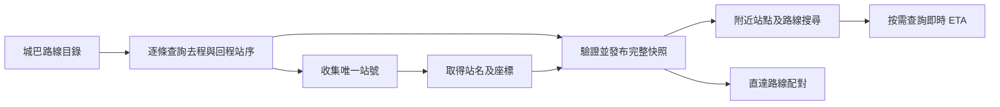

# 城巴（Citybus）資料接入研究

研究日期：2026-10-13（香港時間）。程式基準：`main`，`9a3b7bd`。
本文件保留原研究的官方文件、少量實際 API 查詢及接入建議。
2026-10-14 的首階段實作狀態及驗證紀錄見下方連結的計劃文件。
「實測」代表當時的觀察，不代表服務可用性或效能保證；「建議」代表待實作的設計。

> 2026-10-14 範圍更新：使用者已確認首階段接入城巴路線搜尋、詳情（方向、站序、地圖及選定站點 ETA）；
> 城巴收藏暫緩，附近站點 ETA 頁不接入城巴。
> 當前計劃見 [城巴路線搜尋首階段計劃](CITYBUS_ROUTE_SEARCH_PLAN.md)。
> 下文原先涵蓋全功能接入的「第一版」及索引、收藏遷移建議改列為後續擴充研究，不是本階段工作。

## 結論

可以使用 DATA.GOV.HK 發布的城巴資料，接入路線搜尋、路線詳情、附近站點、ETA、收藏及直達路線搜尋。
建議第一版採用城巴 **V2 API** 作主要來源，保留目前九巴（KMB）供應器，新增城巴供應器（provider）。
先完成營辦商識別及城巴靜態站點索引，再開放附近站點；整站批次 ETA 可作後續效能優化。

城巴官方 V2 文件涵蓋原新巴路線，統一使用 `CTB`，並要求遷移離開舊城巴 V1/V1.1。
DATA.GOV.HK 部分資源頁和其連出的舊規格仍顯示 `citybus-nwfb`，接入時應以
[城巴 V2 API 規格 2.01](https://www.citybus.com.hk/datagovhk/bus_eta_api_specifications.pdf)為準。
這個淘汰說明指城巴舊介面，不能套用到另一套 `/transport/batch/` API。

## 官方來源與端點

[城巴資料集](https://data.gov.hk/tc-data/dataset/ctb-eta-transport-realtime-eta)
列明 ETA 每分鐘更新，其他資料有變動時更新，資料知識產權屬城巴有限公司。
以下端點均為公開 `GET`；本次請求沒有使用 API 金鑰或登入憑證。

城巴主 API 基底：`https://rt.data.gov.hk/v2/transport/citybus`。
端點參數及方向定義見[官方 V2 規格](https://www.citybus.com.hk/datagovhk/bus_eta_api_specifications.pdf)。

| 用途 | 基底之後的路徑 | 接入用途 |
| --- | --- | --- |
| 公司資料 | `/company/CTB` | 來源標示 |
| 全部路線 | `/route/CTB` | 搜尋目錄 |
| 單一路線 | `/route/CTB/{route}` | 雙語起訖點 |
| 單一站點 | `/stop/{stopId}` | 雙語站名、經緯度 |
| 指定方向站序 | `/route-stop/CTB/{route}/{direction}` | 路線詳情、直達搜尋索引 |
| 指定站點及路線 ETA | `/eta/CTB/{stopId}/{route}` | 雙語目的地、備註及預報 |

`direction` 路徑使用 `outbound` 或 `inbound`；回應的 `dir` 分別為 `O`、`I`。
回程起訖點按方向對調，但只應為實際存在、具有站序的方向建立可點選詳情。

政府另提供[指定站點路線及 ETA 批次資料集](https://data.gov.hk/en-data/dataset/hk-dpo-datagovhk1-transport-bus-route-list-and-eta-spcific-bus-stop)，
由伺服器代為彙集城巴資料。以下路徑的基底是 `https://rt.data.gov.hk`：

| 用途 | 路徑 | 本站取捨 |
| --- | --- | --- |
| 整站路線 | `/v1.1/transport/batch/stop-route/CTB/{stopId}` | 可按需列出無 ETA 的路線 |
| 整站 ETA | `/v1/transport/batch/stop-eta/CTB/{stopId}?lang=zh-hant` | 降低附近站點查詢次數 |

批次 ETA 的 `lang` 支援 `en`、`zh-hant`、`zh-hans`；回應使用單語 `dest`、`rmk`，
並非 V2 的 `dest_en`、`dest_tc`、`rmk_en`、`rmk_tc`。
介面版本及錯誤碼見[政府批次 API 規格 1.3](https://static.data.gov.hk/opendata/eta/bus-route-list-and-eta-specific-stop-api-specifications.pdf)。

## 實測結果

2026-10-13 約 21:33–21:35 HKT，對下列端點各作少量查詢。
V2 公司、全部路線、單一站點、兩個方向站序及 ETA 均成功；批次路線及中英文 ETA 亦成功。

| 查詢 | 結果 |
| --- | --- |
| `/route/CTB` | HTTP 200；409 筆路線，沒有 `bound` 或 `service_type` |
| `/stop/002737` | HTTP 200；站名「砵典乍街, 德輔道中」；`lat`、`long` 實際為字串 |
| `/stop` | HTTP 422，`Invalid/Missing parameter(s)`；不能當全部站點 API |
| `/route-stop/CTB/1/outbound` | HTTP 200；20 個站序記錄 |
| `/route-stop/CTB/1/inbound` | HTTP 200；18 個站序記錄 |
| `/eta/CTB/002737/101` | HTTP 200；3 筆記錄，`eta: ""`，備註「九巴時段」 |
| `/eta/CTB/001027/1` | HTTP 200；5 筆記錄，包含有效預報；不能假設整個回應最多 3 筆 |
| 批次路線，站點 `002737` | HTTP 200；6 筆路線／方向／站序記錄 |
| 批次 ETA，站點 `002737`，`zh-hant` | HTTP 200；11 筆記錄，單語目的地及備註 |

其中 `/eta/CTB/001027/1` 的前兩筆為 `dir: "I"`、`seq: 18`，
但同一站點亦是剛取得的去程首站。**ETA 必須按方向和上車站序過濾，不能只按路線及站號。**

本次靜態回應的標頭為 `Cache-Control: max-age=300`，ETA 為 `max-age=45`；
亦觀察到 `Access-Control-Allow-Origin: *`。這些是當時標頭，不是永久承諾。
仍建議經本站伺服器讀取，以統一驗證、快取、逾時及供應器錯誤處理。
全部路線的一次請求約需 15 秒，故不應讓冷啟動靜態匯入阻塞使用者的 ETA 請求。

可重做的唯讀查詢範例（數量和預報會隨時間改變）：

```sh
curl --fail-with-body --max-time 25 'https://rt.data.gov.hk/v2/transport/citybus/route/CTB'
curl --fail-with-body --max-time 25 'https://rt.data.gov.hk/v2/transport/citybus/route-stop/CTB/1/outbound'
curl --fail-with-body --max-time 25 'https://rt.data.gov.hk/v2/transport/citybus/stop/002737'
curl --fail-with-body --max-time 25 'https://rt.data.gov.hk/v2/transport/citybus/eta/CTB/001027/1'
curl --fail-with-body --max-time 25 'https://rt.data.gov.hk/v1/transport/batch/stop-eta/CTB/002737?lang=zh-hant'
```

## 目前程式需要改動的地方

以下是檢閱本儲存庫後的結果，並非上游 API 要求。

| 現有位置 | 已確認的限制 | 建議變更 |
| --- | --- | --- |
| `src/lib/types.ts` | 站點無營辦商；路線、收藏、直達配對皆依賴九巴 `serviceType` | 建立帶 `operator` 的共用身份及供應器專屬路線識別 |
| `src/lib/routeVariants.ts` | 路線鍵僅 `route + bound + serviceType`；反方向搜尋亦無營辦商範圍 | 鍵值與反方向搜尋加入 `operator` |
| `src/lib/server/kmbRoutes.ts`、`kmbRouteStops.ts` | 使用九巴全集及每日快取 | 保留九巴實作，新增城巴來源及靜態快照 |
| `src/app/api/stops/route.ts` | 僅回傳九巴站點 | 彙集已就緒的供應器，回報個別來源狀態 |
| `src/app/api/stop-eta/[stopId]/route.ts` | 站號至少 8 字元；要求 `service_type`；拒絕 `eta: ""` | 依營辦商選擇驗證器與轉接器 |
| `src/lib/kmb.ts`、`src/hooks/useStopETAs.ts` | 客戶端只傳站號；以站號儲存 ETA 狀態 | 改傳營辦商及原始站號；狀態鍵加入營辦商 |
| `src/lib/clientStops.ts`、`useNearbyStops.ts` | 全部站點快取受九巴服務日驅動 | 支援各來源快照版本及來源更新狀態 |
| `src/app/api/direct-routes/route.ts` | 拒絕六位城巴站號；只載入九巴站序 | 使用供應器索引和有營辦商的站點候選 |
| `src/lib/directRouteMatcher.ts`、`etaEligibility.ts`、`routeEta.ts` | 精確配對無營辦商，且要求九巴服務類型 | 保留方向及站序約束，增加營辦商範圍 |
| `src/lib/favourites.ts`、`FavouriteContext.tsx`、收藏 API | v2 收藏沒有營辦商 | 版本升級及舊九巴收藏遷移 |
| 路線頁、`ETARow.tsx`、`NearbyRouteGroup.tsx` | 詳情連結只有路線、方向及服務類型 | 連結攜帶營辦商，顯示「九巴／城巴」標示 |
| `src/lib/site.ts`、README、`THIRD_PARTY_NOTICES.md` | 描述及資料來源僅涵蓋九巴 | 功能接入後補上城巴及來源連結 |

現有 `src/lib/geo.ts` 的距離篩選可沿用；站點須先正規化為數值座標並保留營辦商身份。

## 建議的資料模型與轉接邊界

1. **營辦商是身份的一部分。** 共用資料新增 `operator: 'KMB' | 'CTB'`。
   原始站號保留字串，城巴如 `002737` 不能轉為整數。站點鍵使用 `CTB:002737`；
   同站名、同座標也不可自動合併不同站台或不同營辦商的資料。
2. **城巴路線不是九巴服務類型。** 建議採用可區分的聯集型別（discriminated union）：
   九巴身份為 `operator + route + bound + serviceType`；城巴為 `operator + route + bound`。
   不把缺少的 `service_type` 默認為真實的九巴類型 `1`，也不從路線號推斷特別服務。
   城巴官方公開欄位沒有提供等價的服務類型，第一版需明確限制於公開站序可表達的路線。
3. **上車點保留出現次序。** 收藏、詳情和直達配對包含 `operator + variant + stopId + boardingSeq`。
   所有過濾、去重、快取及 React 鍵值採用同一組身份規則。
4. **在伺服器正規化上游。** `dir` 轉為共用 `bound`；座標字串轉為有限數值；
   `eta: ""` 或 `null` 轉為 `null` 並保留備註；非空但無效的時間視為格式錯誤。
   不因單筆空 ETA 拒絕整站有效回應，也不把資料異常當成「沒有班次」。
5. **保留上游時間。** 共用回應保留 `generated_timestamp`、各筆 `data_timestamp` 及本地 `fetchedAt`。
   現有 `etaFreshness.ts` 只看最後成功收到回應的時間；新增快取時應將傳輸成功和資料年齡分開，
   不能每次收到同一份舊回應便重新顯示「剛更新」。

欄位差異、六位站號、WGS84 座標及循環線方向切分見
[城巴資料字典 2.01](https://www.citybus.com.hk/datagovhk/bus_eta_data_dictionary.pdf)。
循環線沒有獨立標示，會在轉折點切成去／回程。建議第一版僅在同一公開方向內做直達配對；
跨轉折點行程應列為尚未支援，未驗證連續行車關係前不可自行拼接兩個方向。

## 建立附近站點及直達搜尋索引

本站目前依賴九巴單次取得全站點、全站序的方式。城巴必須先匯入靜態資料。
建議建立離線／排程匯入程序，流程如下：



- 初次匯入請求量估算：`1 + 2R + S`，`R` 為路線數、`S` 為唯一站號數。
  以本次 409 條路線估算，站點查詢前已需約 819 次請求；這是設計估算，未執行完整匯入。
  `S` 及整體匯入耗時仍未量測。
- 只從路線站序收集站號，不逐個猜測六位號碼。限制併發、逾時及重試次數；遇到 HTTP 429 退避，
  如有 `Retry-After` 就遵從。官方文件有 429，但本次未確認固定的每秒額度。
- 已有站名和座標可重用，新增站號才補查，另安排週期性的完整站點更新以捕捉搬站及改名。
  路線及站序應定期重抓；建議初期每日更新並容許手動刷新，此頻率是產品設計，不是官方 SLA。
- 快照包含路線、方向、完整有序站序、站點及建立時間；檢查站號參照、方向、序號及座標完整性後原子發布。
  部分請求失敗時不發布缺站的新版本。回程合法空集合和上游失敗必須分開處理。
- 快照放在可持久化的儲存空間，例如目前 Docker 部署可掛載的資料卷；容器重啟不應再全面抓取。
  排程寫入方式須配合實際部署環境。多執行個體需共用快照，或使用同版本的唯讀快照。
- 舊快照失效時可保留並標示來源過期；直達配對應有產品設定的最大資料年齡，超過後停止提供可靠配對。
  沒有快照時顯示「城巴資料準備中／暫時無法取得」，九巴仍可運作。
- 不沿用九巴固定的 05:10 服務日作城巴更新契約。本次靜態時間約為 05:00，只是觀察。

## 即時 ETA 的接入取捨

**第一版建議：V2 按路線查詢。** 使用快照中的站點到路線索引，對顯示中的站點及路線按需查詢。
它直接提供現有畫面需要的雙語目的地及備註，無須在語言切換時重新拼裝不同時間的回應。
缺點是一次整站刷新約需該站不同路線數量的請求。

加上有上限的併發佇列、相同 `operator + stopId + route` 的進行中請求共用，
以及約 30 秒的短期伺服器快取作初始調校值；快取總年齡仍必須計入顯示的新鮮度。
現有 30 秒畫面刷新間隔可以保留，但不能宣稱上游也每 30 秒產生新資料。
其中一路線逾時不應刪除同站其他成功的路線資料；回應需表達部分失敗。

**後續優化：整站批次 ETA。** 一個站點及一種語言只需一次請求，更適合大型附近站點清單。
但須先調整共用模型和畫面：將 `dest`、`rmk` 標示為特定語言的文字，快取鍵加入 `lang`，
切換語言重抓；不可把英文備註塞入中文欄位。若同抓中英文，必須處理兩次回應預報改變的情況。
建議量測每站請求數、延遲及部分失敗率後，再決定是否改為批次來源。

聯營路線的公開限制是城巴不提供另一營辦商的 ETA，而以備註說明，見
[官方 ETA 資源說明](https://data.gov.hk/tc-data/dataset/ctb-eta-transport-realtime-eta/resource/7681185f-fbd5-4b34-b422-91423310299c)。
本站應保留「九巴時段」通知，繼續透過既有九巴來源提供九巴預報。
第一版分別顯示兩個營辦商；未有驗證過的站點及方向對照前，不合併成同一預報清單。

## API 相容性與收藏遷移

建議沿用目前頁面結構，在 API 和詳情 URL 加上 `operator`；舊連結未帶營辦商時按既有契約解讀為九巴。
這是根據現有功能制定的向後相容規則，並非從站號形狀猜測營辦商。

- 詳情範例：`/routes/1?operator=CTB&bound=O&stop=001027&seq=1`。
  九巴仍需 `serviceType`；城巴詳情不應經過九巴的必填 `serviceType` 驗證。
- ETA 範例：`/api/stop-eta/002737?operator=CTB`。
  伺服器只接受支援的營辦商及相應站號格式，不允許客戶端指定任意上游網址。
- 直達搜尋候選改為帶營辦商的站點參照；回應配對包含營辦商。
  同一路線號但不同營辦商不可互相配對。
- 收藏使用新儲存版本：既有 v2 項目遷移時加 `operator: 'KMB'`，保留站號、服務類型與 `boardingSeq`。
  遷移失敗不得覆寫舊值。原本缺少 `boardingSeq` 且有重複站點的收藏繼續顯示需要確認的狀態。
- 來源故障應逐個營辦商回報；城巴暫時不可用不能令所有九巴收藏、搜尋或附近站點消失。

已閱讀安裝中的 Next.js 16.2.1 本地 `Route Handlers` 及 `fetch` 指南。
實作時須保留非同步路由參數處理；路由處理器預設不快取，`fetch` 也不會替路由處理器自動去重。
建議由供應器明確管理短期快取、請求共用和快照，本站 ETA 回應使用 `Cache-Control: no-store`，
避免瀏覽器疊加不透明快取。不要同時設定衝突的 `cache: 'no-store'` 和正數 `next.revalidate`。

## 實作次序及驗收

1. 建立營辦商身份與供應器邊界，完成舊 URL、收藏及九巴測試的相容性。
2. 新增城巴 V2 轉接器及持久化靜態匯入，先接入路線搜尋、方向、站序和地圖。
3. 將城巴快照接到附近站點、V2 ETA、收藏及直達搜尋，加入來源狀態及營辦商標示。
4. 量測請求負載，再評估整站批次 ETA；另行驗證跨循環線轉折點及任何聯營資料合併。

實作時應加入的重點測試：

- 六位站號保留前置零，座標字串正規化，空 ETA 保留通知，格式錯誤與空資料分開。
- 城巴／九巴同一路線號不碰撞；同一站號不同方向及站序的 ETA 不互相混入。
- 去／回程起訖點正確；沒有回程時不顯示無效詳情；循環線不產生未驗證的跨方向直達行程。
- 收藏遷移保留舊身份與重複站序處理；舊九巴連結仍可開啟。
- 上游 429、逾時、部分路線失敗及快照重啟可恢復；另一營辦商維持可用。
- 同一份舊資料反覆成功回傳時，不把預報年齡歸零；雙語目的地及通知正確顯示。

本次是研究及文件變更，未修改執行程式，未執行完整靜態匯入、網站整合測試或負載測試。
實作完成後應執行專案要求的 `pnpm test` 及 `pnpm build`，並以官方 API 做少量手動驗證。

## 資料來源標示

接入後在網站可見的資料來源位置，以及 README／`THIRD_PARTY_NOTICES.md` 加入城巴及資料集連結。
[DATA.GOV.HK 使用條款](https://data.gov.hk/tc/terms-and-conditions)要求註明來源和相關知識產權擁有人；
專案 MIT 授權不會重新授權上游資料。此研究只記錄公開條款，不提供法律判定。

建議來源文字：「城巴資料由城巴有限公司提供，經 DATA.GOV.HK 發布；資料知識產權屬城巴有限公司。」
不要以網站功能標示暗示城巴的官方認可。
